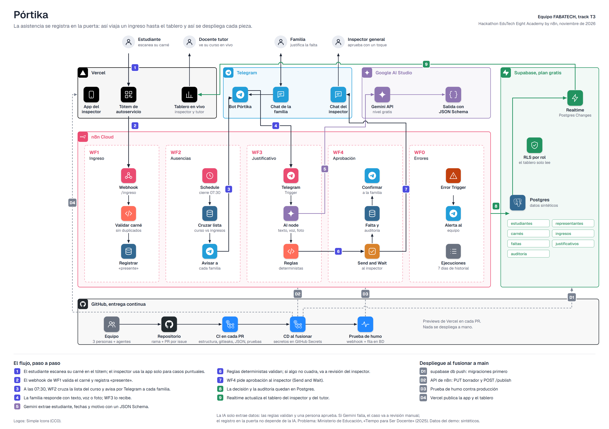

# Pórtika · la asistencia se registra en la puerta

Hackathon EduTech Eight Academy by n8n · 27 y 28 de noviembre de 2026 · Track **T3 · Soluciones comerciales y administrativas para instituciones**.

> **Pórtika** es la app web y el bot de Telegram. Los formatos entre piezas están en [`docs/contratos.md`](docs/contratos.md) y el plan, en [`docs/plan.md`](docs/plan.md).
>
> Estado: **checkpoint 1** (problema, usuario, evidencia y arquitectura). El nombre del producto es provisional.

## Problema

Tomar asistencia y controlar el ingreso y la salida de estudiantes es **la tarea que más tiempo consume a los docentes fuera de clase** en Ecuador, según el propio Ministerio de Educación. A eso se suma seguir cada falta: averiguar el motivo con la familia, recibir el justificativo y registrarlo. Todo es manual, se repite cada día y quita horas a enseñar.

## Usuario

- **Principal:** el **inspector general** de un colegio, que controla la puerta y gestiona las faltas y sus justificativos.
- **Secundario:** el **docente tutor**, que hoy toma lista en cada clase.
- **Del otro lado:** la **familia (representante)**, que debe justificar las faltas.

## Evidencia

Todas las cifras tienen fuente. Lo que es cálculo propio está marcado.

1. **Estrategia "Tiempo para Ser Docente", Ministerio de Educación, 2025** ([PDF oficial](https://educacion.gob.ec/wp-content/uploads/downloads/2025/08/estrategia-tiempo-para-ser-docente.pdf)):
   - Se basó en una «encuesta a 9.957 docentes» (Tabla 2).
   - Dentro del plantel, las tareas fuera de clase requieren «alrededor de 15 horas semanales». Eso «sobrepasa entre un 33% y 40% del tiempo disponible» que fija la norma (11 h 15 min) (Tabla 3).
   - «Las tareas que demandan mayor cantidad de tiempo son: el "Traslado de los estudiantes a las instituciones educativas" y el "Registro de asistencia", con el 44,44% cada una».
   - En total, los docentes estiman 27 h 47 min semanales de tareas fuera de clase frente a las 21 h 15 min normativas. El Ministerio se propone recortar 6 h 32 min (Tabla 5).
2. **Déficit docente:** el Ministerio reconoció «un déficit de 2 223 docentes en el país» al iniciar el año lectivo Sierra–Amazonía 2024 ([Ecuavisa, 29-ago-2024](https://www.ecuavisa.com/sociedad/regreso-a-clases-2024-el-ministerio-de-educacion-reconoce-que-hay-un-deficit-de-2-223-profesores-20240829-0045.html)). Cada hora docente cuenta.
3. **Volumen en un colegio tipo** (dataset ficticio de la mesa técnica: 240 estudiantes, septiembre a diciembre de 2025, recalculado por nosotros):
   - 18.480 registros de asistencia;
   - **706 faltas injustificadas**, 607 justificadas y 655 atrasos.

   Cada falta implica contactar a la familia y gestionar un justificativo.

**Cálculo propio:** 44,44 % de las 11 h 15 min semanales ≈ **5 h por docente a la semana** en registro de asistencia. Con 14 docentes (dataset), son unas 70 h semanales del colegio. Es el techo del ahorro; la meta concreta se fija en la spec.

## Qué NO resolvemos

- No reemplazamos el sistema oficial de calificaciones y asistencia del Ministerio (SIEE): generamos el registro que luego se carga ahí.
- Sin reconocimiento facial ni biometría.
- No es un sistema de seguridad física ni policial.
- La IA nunca decide sola si una falta queda justificada: lo aprueba una persona.

## Cómo libera tiempo docente

| Hoy (manual) | Con el sistema | Paso |
| --- | --- | --- |
| El docente toma lista en cada clase y la registra | La asistencia se registra sola cuando el estudiante escanea su carné en el tótem de la puerta (o el inspector con la app) | 1–2 |
| Alguien llama o escribe a la familia de cada ausente | n8n detecta a los ausentes y escribe a cada familia por Telegram | 3 |
| Se espera el justificativo, se lee y se transcribe a mano | La familia responde con texto, voz o foto; la IA extrae los datos y unas reglas fijas los validan | 4–6 |
| Se revisa caso por caso con todo el contexto disperso | El inspector recibe el caso armado y aprueba o rechaza con un toque | 7 |
| El tutor arma reportes del curso | El tutor ve su curso en vivo en el tablero | 9 |

La meta concreta de horas ahorradas se fija y se mide en la spec. El techo es el cálculo de la sección Evidencia.

## Arquitectura

Fuente editable: [`docs/arquitectura.svg`](docs/arquitectura.svg). Se regenera con `python scripts/diagrama_arquitectura.py scripts/iconos docs/arquitectura.svg docs/_render.html`. Los logos son de [Simple Icons](https://simpleicons.org) (CC0).

El diagrama tiene una zona por proveedor (Vercel, Telegram, Google AI Studio, n8n Cloud, Supabase y GitHub). Dentro de n8n hay una columna por workflow con sus nodos en orden. Los cuadros azules 1–9 son el flujo del demo y los grises D1–D4 son el despliegue.

### El flujo, paso a paso (los mismos números del diagrama)

1. El estudiante escanea su carné en el **tótem de autoservicio** (lector QR USB o cámara en una tablet fija). El inspector usa la misma app desde su celular solo para casos puntuales. Así la puerta no se vuelve un cuello de botella.
2. El escaneo llega a **WF1 · Ingreso**, que registra «presente».
3. Al cerrar el ingreso, **WF2 · Ausencias** detecta a los ausentes y escribe a cada familia.
4. La familia responde con texto, nota de voz o foto (**WF3 · Justificativo**).
5. **Gemini** extrae estudiante, fechas y motivo en un JSON con esquema.
6. **Reglas deterministas** validan tres cosas: que el representante corresponda al estudiante, que las fechas sean faltas reales y que esté dentro del plazo. Si algo no cuadra, el caso va a **revisión manual**.
7. **WF4 · Aprobación** pide al inspector aprobar o rechazar en Telegram (Send and Wait).
8. Cada paso queda en **Postgres**, con auditoría.
9. **Realtime** actualiza el tablero que ven el inspector y el tutor.

**WF0 · Errores** (Error Trigger) avisa al equipo si cualquier ejecución falla.

Si hay tiempo, después del flujo principal:
- salida con código de retiro de un solo uso generado por la familia;
- modo emergencia: aviso masivo con acuse de lectura y lista de quién sigue dentro del plantel.

### Capas

| Capa | Pieza | Elección | Por qué (fuente) |
| --- | --- | --- | --- |
| Personas | Inspector, familia, docente tutor | — | Quien vive el problema y quien lo aprueba |
| Interfaces | Puerta (tótem o app) y tablero en vivo | Web en Vercel Hobby | Preview por PR y producción al fusionar ([Vercel](https://vercel.com/docs/deployments/environments#preview-environment-pre-production)) |
| Interfaces | Bot de Telegram | Telegram Trigger y Send and Wait | Botones, voz y fotos; aprobación humana nativa ([n8n Telegram](https://docs.n8n.io/integrations/builtin/app-nodes/n8n-nodes-base.telegram/message-operations/#send-and-wait-for-response)) |
| Orquestación | WF0 a WF4 | n8n Cloud Starter, instancia del equipo | API pública, 5 ejecuciones concurrentes, 2.500 ejecuciones al mes ([pricing](https://n8n.io/pricing/), [API](https://docs.n8n.io/connect/n8n-api)) |
| IA y reglas | Gemini y reglas deterministas | Gemini, nivel gratis (texto, audio e imagen) | Entrada multimodal gratuita ([AI Studio](https://aistudio.google.com/docs/pricing)) |
| Datos | Postgres, RLS y Realtime | Supabase, plan gratis | Postgres Changes actualiza el tablero sin recargar ([Supabase Realtime](https://supabase.com/docs/guides/realtime/postgres-changes)) |

### Entrega continua (nada se despliega a mano)

- **En cada PR:** CI valida la estructura, los secretos, los JSON de n8n y las pruebas. Vercel crea una preview.
- **Al fusionar a `main`**, en este orden (D1 a D4 en el diagrama):
  1. Migraciones de la base con `supabase db push` ([Supabase](https://supabase.com/docs/guides/deployment/managing-environments)). Siempre antes de publicar workflows.
  2. GitHub Actions publica los workflows en n8n por su API: `PUT` como borrador y luego `POST /publish` ([API de workflows](https://docs.n8n.io/connect/n8n-api/build-and-run/workflows)).
  3. Prueba de humo contra el webhook de producción, que comprueba que se escribió la fila.
  4. Vercel publica la app y el tablero.

**Pendiente de probar en vivo:** que la API key de la instancia del equipo publique un workflow de prueba. Si falla, el plan B es importar el JSON validado desde el editor.

**Qué verifica el sistema y qué pasa si falla:**
- La IA solo extrae datos. Reglas deterministas validan identidad, fechas contra faltas reales y formato, y una persona aprueba.
- Si la IA falla o devuelve algo inválido, el caso va a revisión manual. El registro de asistencia en la puerta no depende de la IA.

## Cómo correrlo

_Pendiente (checkpoint 2):_ `.env` desde `.env.example`, migraciones de Supabase, importación de `n8n/*.json` y despliegue del front.

## Datos y privacidad

Solo datos sintéticos (ver [`data/README.md`](data/README.md)). En una implementación real, los datos de estudiantes menores de edad se protegerían así:
- RLS por rol (el inspector ve su colegio; la familia, solo a sus hijos);
- claves solo en el servidor;
- retención mínima de las fotos de justificativos;
- auditoría de cada aprobación.

## Uso de IA y trabajo previo

- [`AI_USAGE.md`](AI_USAGE.md): qué herramientas de IA usamos y para qué.
- [`PRIOR_WORK.md`](PRIOR_WORK.md): lo que no se escribió durante el evento.

## Equipo FABATECH

| Integrante | GitHub | Rol |
| --- | --- | --- |
| Johann Pasquel (capitán) | [@Vladimirjon](https://github.com/Vladimirjon) | Datos e IA |
| Brandon Ismael Freire | [@BrandonFreire](https://github.com/BrandonFreire) | Automatización |
| Jorge Torres | [@Almejandro04](https://github.com/Almejandro04) | Construcción |

## Licencia

[MIT](LICENSE).
