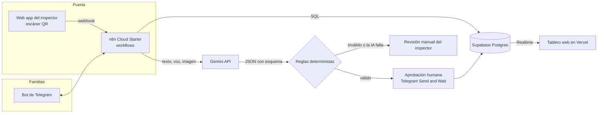

# edutech26-t3-fabatech · Asistencia que se registra en la puerta

Hackathon EduTech Eight Academy by n8n · 27 y 28 de noviembre de 2026 · Track **T3 · Soluciones comerciales y administrativas para instituciones**.

> Estado: **checkpoint 1** (problema, usuario, evidencia y arquitectura). El nombre del producto es provisional.

## Problema

Tomar asistencia y controlar el ingreso y la salida de estudiantes es **la tarea que más tiempo consume a los docentes fuera de clase** en Ecuador, según el propio Ministerio de Educación. A eso se suma seguir cada falta: averiguar el motivo con la familia, recibir el justificativo y registrarlo. Todo es manual, se repite cada día y quita horas a enseñar.

## Usuario

- **Principal:** el **inspector general** de un colegio, que controla la puerta y gestiona las faltas y sus justificativos.
- **Secundario:** el **docente tutor**, que hoy toma lista en cada clase.
- **Del otro lado:** la **familia (representante)**, que debe justificar las faltas.

## Evidencia

Todas las cifras tienen fuente. Lo que es cálculo propio está marcado.

1. **Estrategia "Tiempo para Ser Docente", Ministerio de Educación, 2025** ([PDF oficial](https://educacion.gob.ec/wp-content/uploads/downloads/2025/08/estrategia-tiempo-para-ser-docente.pdf)):
   - Se basó en una «encuesta a 9.957 docentes» (Tabla 2).
   - Dentro del plantel, las tareas fuera de clase requieren «alrededor de 15 horas semanales». Eso «sobrepasa entre un 33% y 40% del tiempo disponible» que fija la norma (11 h 15 min) (Tabla 3).
   - «Las tareas que demandan mayor cantidad de tiempo son: el "Traslado de los estudiantes a las instituciones educativas" y el "Registro de asistencia", con el 44,44% cada una».
   - En total, los docentes estiman 27 h 47 min semanales de tareas fuera de clase frente a las 21 h 15 min normativas. El Ministerio se propone recortar 6 h 32 min (Tabla 5).
2. **Déficit docente:** el Ministerio reconoció «un déficit de 2 223 docentes en el país» al iniciar el año lectivo Sierra–Amazonía 2024 ([Ecuavisa, 29-ago-2024](https://www.ecuavisa.com/sociedad/regreso-a-clases-2024-el-ministerio-de-educacion-reconoce-que-hay-un-deficit-de-2-223-profesores-20240829-0045.html)). Cada hora docente cuenta.
3. **Volumen en un colegio tipo** (dataset ficticio de la mesa técnica: 240 estudiantes, septiembre a diciembre de 2025, recalculado por nosotros):
   - 18.480 registros de asistencia;
   - **706 faltas injustificadas**, 607 justificadas y 655 atrasos.

   Cada falta implica contactar a la familia y gestionar un justificativo.

**Cálculo propio:** 44,44 % de las 11 h 15 min semanales ≈ **5 h por docente a la semana** en registro de asistencia. Con 14 docentes (dataset), son unas 70 h semanales del colegio. Es el techo del ahorro; la meta concreta se fija en la spec.

## Qué NO resolvemos

- No reemplazamos el sistema oficial de calificaciones y asistencia del Ministerio (SIEE): generamos el registro que luego se carga ahí.
- Sin reconocimiento facial ni biometría.
- No es un sistema de seguridad física ni policial.
- La IA nunca decide sola si una falta queda justificada: lo aprueba una persona.

## Solución (flujo principal del demo)

1. **Ingreso.** El inspector escanea el QR del carné con su teléfono en la puerta. La asistencia del día queda registrada al instante.
2. **Ausencias.** Al cerrar el ingreso, n8n cruza la lista de cada curso con los ingresos y avisa a la familia de cada ausente por Telegram.
3. **Justificativo.** La familia responde con texto, nota de voz o foto del certificado. La IA (Gemini) extrae estudiante, fechas y motivo en un JSON con esquema. Luego reglas deterministas validan:
   - que el estudiante pertenece a ese representante;
   - que las fechas coinciden con faltas reales;
   - que el formato y el plazo son válidos.
4. **Aprobación.** El inspector aprueba o rechaza con un toque en Telegram. La falta pasa a justificada y queda auditada.
5. **Tablero en vivo.** Inspector y tutores ven ingresos, ausentes, justificativos pendientes y horas ahorradas, sin recargar la página.

Si hay tiempo (después del flujo principal): salida con código de retiro de un solo uso para la familia, y modo emergencia (aviso masivo con acuse de lectura y lista de quién sigue dentro del plantel).

## Arquitectura

| Pieza | Elección | Por qué (fuente) |
| --- | --- | --- |
| Orquestación | n8n Cloud Starter | API pública, 5 ejecuciones concurrentes, 2.500 ejecuciones al mes ([n8n pricing](https://n8n.io/pricing/), [API](https://docs.n8n.io/connect/n8n-api)) |
| Canal con familias y aprobación | Telegram Trigger y "Send and Wait for Response" | Botones, voz y fotos; aprobación humana nativa ([docs n8n Telegram](https://docs.n8n.io/integrations/builtin/app-nodes/n8n-nodes-base.telegram/message-operations/#send-and-wait-for-response)) |
| IA | Gemini, nivel gratis (texto, audio e imagen) | Entrada multimodal gratuita ([AI Studio pricing](https://aistudio.google.com/docs/pricing)) |
| Datos y tiempo real | Supabase (Postgres, Realtime y RLS) | Postgres Changes en el plan gratis ([Supabase Realtime](https://supabase.com/docs/guides/realtime/postgres-changes)) |
| Front | Vercel Hobby | Preview por PR y producción al fusionar ([Vercel](https://vercel.com/docs/deployments/environments#preview-environment-pre-production)) |

**Ciclo de entrega (nada se despliega a mano):**
- **PR:** CI valida la estructura, los secretos, los JSON de n8n y las pruebas. Vercel crea una preview.
- **Merge a `main`:**
  - GitHub Actions aplica las migraciones de Supabase (`supabase db push`);
  - publica los workflows en n8n por su API (`PUT` como borrador y luego `POST /publish`);
  - corre una prueba de humo contra el webhook de producción.

**Qué verifica el sistema y qué pasa si falla:**
- La IA solo extrae datos. Reglas deterministas validan identidad, fechas contra faltas reales y formato, y una persona aprueba.
- Si la IA falla o devuelve algo inválido, el caso va a revisión manual. El registro de asistencia en la puerta no depende de la IA.

## Cómo correrlo

_Pendiente (checkpoint 2):_ `.env` desde `.env.example`, migraciones de Supabase, importación de `n8n/*.json` y despliegue del front.

## Datos y privacidad

Solo datos sintéticos (ver [`data/README.md`](data/README.md)). En una implementación real, los datos de estudiantes menores de edad se protegerían así:
- RLS por rol (el inspector ve su colegio; la familia, solo a sus hijos);
- claves solo en el servidor;
- retención mínima de las fotos de justificativos;
- auditoría de cada aprobación.

## Uso de IA y trabajo previo

- [`AI_USAGE.md`](AI_USAGE.md): qué herramientas de IA usamos y para qué.
- [`PRIOR_WORK.md`](PRIOR_WORK.md): lo que no se escribió durante el evento.

## Equipo FABATECH

| Integrante | GitHub | Rol |
| --- | --- | --- |
| Johann Pasquel (capitán) | [@Vladimirjon](https://github.com/Vladimirjon) | Datos e IA |
| Brandon Ismael Freire | [@BrandonFreire](https://github.com/BrandonFreire) | Automatización |
| Jorge Torres | [@Almejandro04](https://github.com/Almejandro04) | Construcción |

## Licencia

[MIT](LICENSE).
